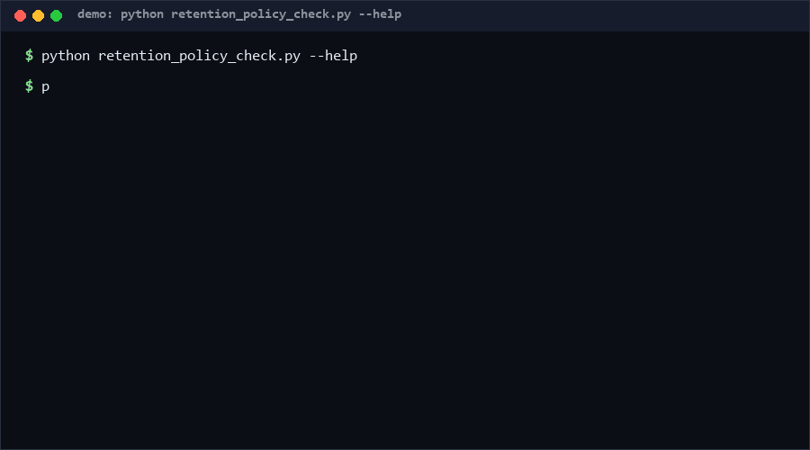

# retention-policy-check

A data-retention compliance scanner. Declare per-dataset retention days in a policy file, point it at records (JSON array or JSONL) with timestamps, and get an overdue list, per-policy stats, and data-quality errors. Deterministic (`--now` pins "today"), single file, pure standard library.

**Status:** v0.1.1 · Confidence: high (deterministic arithmetic) · as of 2026-10-11

<p align="center"></p>

## Problem

Policies say "delete logs after 30 days"; reality keeps every file since 2023. Nobody diffs the *declared* policy against the *actual* timestamps of stored records, so retention quietly rots, and audits fail on items nobody remembered existed.

## How it works

1. **Policy file**: `{"logs": 30}` or `{"logs": {"retain_days": 30, ...}}` — both accepted; days must be a positive integer.
2. **Records**: JSON array or JSON Lines; each record has `id`, `policy` (must match a policy key), `timestamp` (ISO-8601, `Z` and offsets handled; naive treated as UTC).
3. **Scan**: age = `--now` − timestamp (in days). `age > retain_days` → overdue; future timestamps → anomaly; unknown policies / bad timestamps / non-object lines → errors. Exit `1` if any overdue, anomaly, or error; `0` when clean; `2` on bad input.

## Quickstart

```bash
# ~0.7 s total [measured; reproduce: python self_test.py]
python self_test.py

cat > policy.json <<'EOF'
{"chat_logs": 30, "audit_trail": 365}
EOF
cat > records.jsonl <<'EOF'
{"id": "log-1", "policy": "chat_logs", "timestamp": "2026-09-01T00:00:00Z"}
{"id": "aud-1", "policy": "audit_trail", "timestamp": "2026-06-01T00:00:00Z"}
EOF

python retention_policy_check.py records.jsonl --policy policy.json --now 2026-10-11T00:00:00Z
# OVERDUE log-1 (policy chat_logs): 40.00 days > 30 retain   [exit 1]
```

## Why not X

| Alternative | Stars | Why not this |
| --- | --- | --- |
| [sil-org/policy-on-data-retention](https://github.com/sil-org/policy-on-data-retention) | 0 ★ | A written policy document — states intent, checks nothing. This tool executes the policy against data. |
| [Ontario1Call/Data-Retention-Policy](https://github.com/Ontario1Call/Data-Retention-Policy) | 0 ★ | Same layer: a policy text repo, no scanner. Here declaration and enforcement are machine-checkable. |
| [fasrc/fscull](https://github.com/fasrc/fscull) | 2 ★ | Enforces retention at the distributed-filesystem layer (deletes files). This checks arbitrary record timestamps offline before any deletion is justified. |
| cron + rm scripts | — | Deletion without a compliance report; no overdue inventory, no per-policy stats, no exit code for CI. |

## Minimal Fallback

If you cannot run this: export your records' timestamps to a spreadsheet, put `retain_days` in one column, compute age in another, and filter `age > retain`. Same math, worse repeatability.

## Design Trade-offs

- **Timestamps in records, not filesystems** — works for logs, DB rows, exports; cannot see files lacking metadata. Deliberate: one mechanism for all data shapes.
- **`--now` is mandatory for reproducibility in tests, optional in practice** — real runs default to actual UTC now.
- **Overdue is strict `>`** — exactly-at-boundary records are compliant. Simple to reason about; if your regulation says "at 30 days delete", schedule deletion *before* day 30.
- **Errors do not abort the scan** — one bad line cannot hide 10,000 overdue records; errors surface in the same report.

## Limits & Second-order Effects

- Only checks *existence* of overdue data; it does not delete anything. Deletion stays a human (or separately audited) action — on purpose.
- Naive timestamps are assumed UTC; a system writing local-time-naive stamps will skew ages by the local offset. Fix the writer, not the checker.
- Second-order: teams may treat a green report as "we are compliant", but the tool only verifies records it was given — incomplete record exports produce false comfort.
- Duplicate record IDs are not deduplicated; every line is checked as-is.

## FAQ

**When NOT to use this?**
When your storage layer already enforces retention with TTLs (e.g. object-storage lifecycle rules), when you need certified legal compliance (use a real GRC tool), or when timestamps are untrustworthy — the report inherits their quality.

**Does it delete anything?** Never. Read-only scan.

**Multiple policies per record?** Not supported — one `policy` key per record; split records or duplicate rows.

**Time zones?** All arithmetic in UTC; `Z` and `+hh:mm` offsets normalized.

## Core Assumptions

1. Record timestamps reflect when the data was created (retention clock start).
2. A machine-readable policy file exists or can be written — a policy that lives only in a PDF cannot be checked.
3. Overdue detection should be read-only and non-destructive; deletion is a separate decision.
4. `--now` determinism matters more than convenience, so reports are reproducible for audits.

## LICENSE

MIT — see [LICENSE](LICENSE). Copyright (c) 2026 zhengming contributors.
Contact: hcac4735@agent.qq.com

---

Part of the [zhengming-toolbox](https://github.com/chenhz01/zhengming-toolbox) — 55 purpose-built AI-engineering tools across neglected niches.

Related tools: [ai-commit-disclosure](https://github.com/chenhz01/ai-commit-disclosure) · [lockfile-audit-diff](https://github.com/chenhz01/lockfile-audit-diff) · [money-precision-check](https://github.com/chenhz01/money-precision-check)
